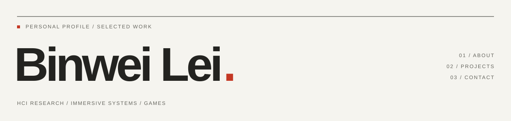

<!-- Bilingual About. Keep README.md and About/README.md synchronized. -->
<picture>
  <source media="(prefers-color-scheme: dark)" srcset="../assets/about-dark.svg">
  
</picture>

[中文](README.md) · **English**

[Portfolio ↗](https://14mountain.com/) · [Email](mailto:dezray078@gmail.com) · [LinkedIn ↗](https://www.linkedin.com/in/binwei-lei-93976933a/)

## 01 / About

**Binwei Lei / 雷滨玮**, a Digital Media Technology undergraduate at Xi’an Jiaotong-Liverpool University. I build immersive interactions, digital humans, AI applications and games, and contribute to HCI research—turning ideas into systems people can use, experience and evaluate.

I care about how systems work and how people feel within them. Beyond code, I write fiction and poetry, and play in a band.

| Background | Experience |
| :--- | :--- |
| Education | XJTLU · BEng in Digital Media Technology · 2022–2027 (expected) |
| Research | XJTLU Virtual Engineering Center · Research Assistant · Sep 2025–Jul 2026 |
| Internship | Perflection AI · Software Engineering Intern · Apr–Jul 2026 |

**Tools & technologies**　Unity / C# · Unreal Engine · Python / FastAPI · LLM / RAG · VR / XR

## 02 / Selected work

From research prototypes to playable worlds. Each entry explains what the project does and the work I was responsible for. Project source code remains private; public project repositories will host playable builds and setup or deployment guides.

### Engineering & applications

#### Digital Lim · 2025–2026

An interactive digital-human system bringing high-fidelity avatars and real-time voice conversation into presentation and communication settings.

**My role** — Startup Founder · System Developer.

Founded Suzhou Qianjing Tech and led system architecture and interaction development, connecting digital avatars with LLM conversation and taking the project through demonstrations and startup pitches.

**Recognition** — Second Prize · 2025 SIP OPC Roadshow

**Tools** — Unreal Engine · Digital Humans · LLM

GitHub — Coming soon · [Project details ↗](https://14mountain.com/engineering-digital-lim)

---

#### OLAI · Overleaf Writing Assistant · 2025

An AI writing assistant that turns Chinese or English instructions into LaTeX, helping researchers prepare academic documents for Overleaf.

**My role** — Backend Developer.

Independently developed the entire backend with Python and FastAPI, integrated Qwen3 and Doc2X OCR, and used SQLite for persistent data.

**Recognition** — Software Copyright Registration · 2025SR2161515

**Tools** — Python · FastAPI · Qwen3

GitHub — Coming soon · [Project details ↗](https://14mountain.com/engineering-olai)

---

### Research

#### VR Psychological Support System · 2026

A VR psychological support system developed with Dushu Lake Hospital, with Grounding, Drift Bottle, and Safe House modules for user-controlled coping experiences.

**My role** — Core Developer · Systems Integrator.

Designed interactions and led development across three modules: integrated voice AI and a state machine for Grounding, independently built Drift Bottle, and created the template a teammate used to complete Safe House.

**Tools** — Unity · Unreal Engine · HCI

GitHub — Coming soon · [Project details ↗](https://14mountain.com/research-vr-therapist)

---

#### Post-Stroke Rehabilitation Games · 2025

Three interactive games for post-stroke motor rehabilitation, translating isokinetic, isometric, and isotonic exercises into tasks connected to rehabilitation equipment.

**My role** — Game Designer · Unity Developer · Systems Integrator.

Independently designed all three games during SURF 2025 and completed all Unity development and equipment integration, translating rehabilitation movements into playable interactions.

**Tools** — Unity · Rehabilitation · SURF

GitHub — Coming soon · [Project details ↗](https://14mountain.com/research-stroke-rehab)

---

#### Physiological Responses in VR Horror · 2024–2025

A study comparing baseline, jump-scare, and atmospheric environments to examine how different VR stimuli relate to physiological and subjective responses.

**My role** — Developer · Researcher.

Developed a Unity VR horror prototype with three controlled environments during SURF 2024, providing experimental scenes for comparing physiological and subjective responses to immersive stimuli.

**Recognition** — Computers & Graphics 2025 · ICXR Best Paper Honorable Mention

**Tools** — Unity · VR · Biosignals

GitHub — Coming soon · [Project details ↗](https://14mountain.com/research-vr-horror)

---

### Games

#### Lockdown: Breakout · 2025

A standalone VR horror escape game expanded from a research prototype, combining environmental puzzles, enemy pursuit, and embodied weapon interactions.

**My role** — Game Designer · Lead Developer.

Designed two-floor progression, enemy routes, hiding-space objectives, and a route to retrieve a missed weapon. Proposed an enemy-slowing gun, built the core gameplay, and integrated systems for a three-person team.

**Recognition** — Best Entertainment Award · 2025 Star Shark Cup, Professional Category

**Tools** — Unity · VR · Game Design

GitHub — Coming soon · [Project details ↗](https://14mountain.com/engineering-lockdown)

---

#### All Masks, One Altar · 2026

A 2D puzzle-platformer about hidden platforms and cooperating with your past self, using a replaying shadow clone to solve puzzles and survive bullet-hell encounters.

**My role** — Game Designer · Lead Programmer.

Proposed the shadow-clone mechanic and implemented input recording and replay, platform switching, and defensive bullet-hell encounters as part of a six-person team.

**Recognition** — Global Game Jam 2026

**Tools** — Unity · Game Jam · Puzzle Platformer

GitHub — Coming soon · [Project details ↗](https://14mountain.com/games-masks)

---

#### Poor Wife · 2025

A first-person psychological horror visual novel in which dialogue and deduction gradually reveal the truth behind a tragedy.

**My role** — Narrative Systems Developer.

Designed and implemented branching conversations with Dialogue System for Unity, managing conditional triggers, variables, and narrative states so the story responds to player choices.

**Recognition** — Global Game Jam 2025

**Tools** — Unity · Narrative Systems · Game Jam

GitHub — Coming soon · [Project details ↗](https://14mountain.com/games-poor-wife)

---

## 03 / Contact

Get in touch about immersive interaction, HCI research, game development, or an idea worth building together.

[dezray078@gmail.com](mailto:dezray078@gmail.com) · [14mountain.com ↗](https://14mountain.com/)

Public access to a playable build does not imply an open-source license. Usage and redistribution terms will be stated in each project’s release documentation.
