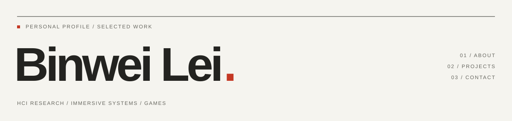

<!-- Bilingual About. Keep README.md and About/README.md synchronized. -->
<picture>
  <source media="(prefers-color-scheme: dark)" srcset="assets/about-dark.svg">
  
</picture>

**中文** · [English](About/README.en.md)

[Portfolio ↗](https://14mountain.com/) · [Email](mailto:dezray078@gmail.com) · [LinkedIn ↗](https://www.linkedin.com/in/binwei-lei-93976933a/)

## 01 / 关于我

**雷滨玮 / Binwei Lei**，西交利物浦大学数字媒体技术本科生。我的实践横跨沉浸式交互、数字人、AI 应用与游戏，也参与人机交互研究，把想法做成可以使用、体验和验证的系统。

我关注系统如何运作，也关注人在其中的感受。代码之外，我也写小说、诗歌，参与乐队。

| 背景 | 经历 |
| :--- | :--- |
| 教育 | 西交利物浦大学 · 数字媒体技术工学本科 · 2022–2027（预计） |
| 科研 | XJTLU 虚拟工程中心 · 科研助理 · 2025.09–2026.07 |
| 实习 | Perflection AI · 软件工程实习生 · 2026.04–2026.07 |

**常用技术**　Unity / C# · Unreal Engine · Python / FastAPI · LLM / RAG · VR / XR

## 02 / 项目经历

从研究原型到可玩的世界。下面记录项目做了什么，以及我具体负责的部分。项目源代码保留私有，后续将在各自的公开仓库提供试玩包与运行／部署教程。

### 工程与应用

#### Digital Lim · 高保真数字人 · 2025–2026

将高保真数字形象与实时语音对话结合，为展示与交流场景构建可交互的数字人系统，并推动技术的商业化。

**我的职责** — 创业发起人 · 系统开发。

创立苏州千境科技，负责数字人系统的技术架构与交互开发，整合虚拟形象和大语言模型对话能力，并推进项目展示、路演与落地。

**相关成果** — 2025 SIP「一港十基地」OPC 路演二等奖

**技术** — Unreal Engine · Digital Humans · LLM

GitHub — 待发布 · [项目详情 ↗](https://14mountain.com/engineering-digital-lim)

---

#### OLAI · Overleaf 智能写作助手 · 2025

面向学术写作的 AI 助手，将中英文自然语言转换为 LaTeX 代码，帮助研究者把想法整理成可用于 Overleaf 的文档。

**我的职责** — 后端开发。

独立完成全部后端开发，以 Python 与 FastAPI 构建服务，接入 Qwen3 和 Doc2X OCR，并使用 SQLite 管理持久数据。

**相关成果** — 软件著作权登记 · 2025SR2161515

**技术** — Python · FastAPI · Qwen3

GitHub — 待发布 · [项目详情 ↗](https://14mountain.com/engineering-olai)

---

### 研究

#### VR 心理支持系统 · 2026

与独墅湖医院合作开发的 VR 心理支持系统，包含安定练习、漂流瓶与安全屋三个模块，探索可由用户掌控的应对体验。

**我的职责** — 核心开发 · 系统集成。

设计三个模块的交互并牵头开发整合：接入安定练习的语音 AI 与状态机，独立开发漂流瓶，并为安全屋搭建供队友扩展的开发模板。

**技术** — Unity · Unreal Engine · HCI

GitHub — 待发布 · [项目详情 ↗](https://14mountain.com/research-vr-therapist)

---

#### 卒中后上肢康复游戏 · 2025

面向卒中后运动康复的三款交互游戏，将等速、等长与等张训练转化为游戏任务，并与康复设备连接以响应实际动作。

**我的职责** — 游戏设计 · Unity 开发 · 设备集成。

在 SURF 2025 项目中独立设计三种训练模式对应的游戏，完成全部 Unity 开发与设备集成，将康复动作转化为可操作的游戏交互。

**技术** — Unity · Rehabilitation · SURF

GitHub — 待发布 · [项目详情 ↗](https://14mountain.com/research-stroke-rehab)

---

#### VR 恐怖体验与生理反应 · 2024–2025

通过基线、突发惊吓与氛围恐怖三个对照环境，研究不同 VR 刺激与参与者生理反应、主观体验之间的关系。

**我的职责** — 开发者 · 研究参与者。

参与 SURF 2024 研究，开发包含三种对照环境的 Unity VR 恐怖原型，为比较不同沉浸刺激下的生理与主观反应提供实验场景。

**相关成果** — Computers & Graphics 2025 · ICXR 最佳论文荣誉提名

**技术** — Unity · VR · Biosignals

GitHub — 待发布 · [项目详情 ↗](https://14mountain.com/research-vr-horror)

---

### 游戏

#### 禁闭：突围 · 2025

从研究原型拓展而来的独立 VR 恐怖逃脱游戏。玩家在废弃设施中解开环境谜题，通过武器交互应对敌人的追逐。

**我的职责** — 游戏设计 · 主程序。

在三人团队中设计双层关卡流程、敌人路线与藏身点，提出减速武器机制，完成核心玩法开发与系统整合，并安排补取遗漏武器的路线。

**相关成果** — 2025 星鲨杯 · 专业组最佳娱乐奖

**技术** — Unity · VR · Game Design

GitHub — 待发布 · [项目详情 ↗](https://14mountain.com/engineering-lockdown)

---

#### All Masks, One Altar · 2026

围绕隐藏平台与过去的自己协作展开的二维解谜平台游戏。玩家利用影分身重放行动，解开机关，并在弹幕中求生。

**我的职责** — 游戏设计 · 主程序。

在六人团队中提出影分身机制，实现玩家输入录制与回放、平台状态切换和防御型弹幕战斗，将异步协作解谜串联为逐步展开的玩法。

**相关成果** — Global Game Jam 2026

**技术** — Unity · Game Jam · Puzzle Platformer

GitHub — 待发布 · [项目详情 ↗](https://14mountain.com/games-masks)

---

#### Poor Wife · 2025

第一人称心理恐怖视觉小说，玩家通过对话与推理逐步拼出悲剧的真相，让叙事选择与探索过程共同推动紧张感。

**我的职责** — 叙事系统开发。

使用 Dialogue System for Unity 设计并实现多分支对话网络，管理条件触发、变量与叙事状态，让剧情能够响应玩家的推理选择。

**相关成果** — Global Game Jam 2025

**技术** — Unity · Narrative Systems · Game Jam

GitHub — 待发布 · [项目详情 ↗](https://14mountain.com/games-poor-wife)

---

## 03 / 联系

欢迎交流沉浸式交互、HCI 研究、游戏开发，或一个值得一起实现的想法。

[dezray078@gmail.com](mailto:dezray078@gmail.com) · [14mountain.com ↗](https://14mountain.com/)

公开试玩包不代表源代码开源；具体使用与再分发条件以各项目的发布说明为准。
