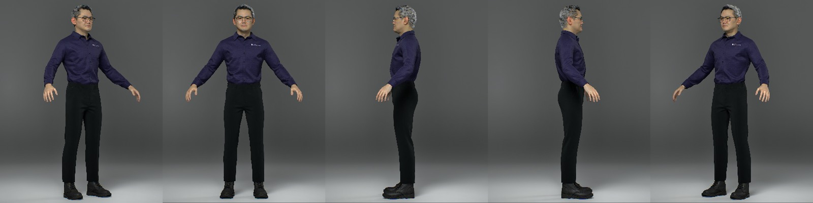
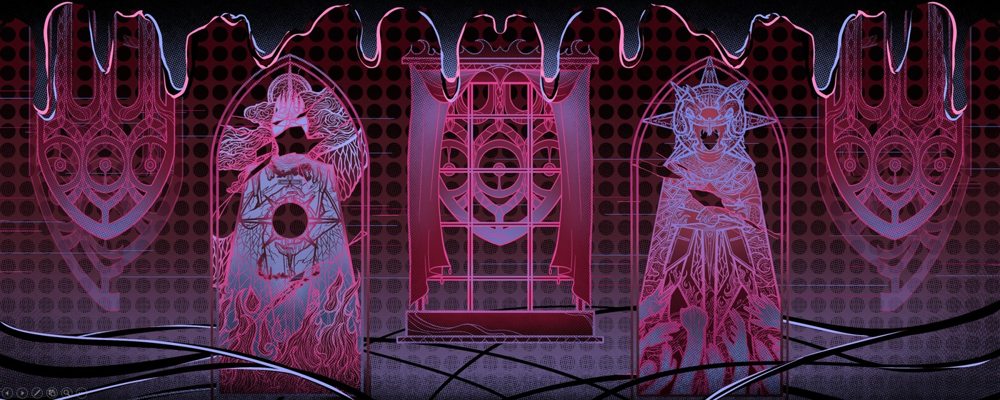

中文 / [English](About/README.en.md)

# Binwei Lei

雷滨玮 · 做 XR 交互、AI 系统与游戏。

西交利物浦大学数字媒体技术本科生。我把想法做成可以体验的系统，也通过研究理解人在其中的感受。代码之外，写小说、诗歌，参与乐队。

[Portfolio ↗](https://14mountain.com/) &nbsp; / &nbsp; [Email](mailto:dezray078@gmail.com) &nbsp; / &nbsp; [LinkedIn ↗](https://www.linkedin.com/in/binwei-lei-93976933a/)

 

背景与经历

- 西交利物浦大学 · 数字媒体技术工学本科，2022–2027（预计）
- XJTLU 虚拟工程中心 · 科研助理，2025.09–2026.07
- Perflection AI · 软件工程实习生，2026.04–2026.07

Unity / C# · Unreal Engine · Python / FastAPI · LLM / RAG · VR / XR

## 精选作品

### Digital Lim

高保真数字人 · 2025–2026 · Unreal Engine / LLM

让数字形象能够实时倾听、回应与交流。 我负责系统架构与交互开发，整合数字形象和大语言模型对话，并推进项目展示与落地。

[查看项目 ↗](https://14mountain.com/engineering-digital-lim) &nbsp; / &nbsp; GitHub · 待发布

### VR 心理支持系统

交互研究 · 2026 · Unity / Unreal Engine

与独墅湖医院合作，探索由用户掌控的 VR 心理支持体验。 我设计三个模块的交互并牵头开发整合；接入安定练习的语音 AI，独立开发漂流瓶，并为安全屋搭建开发模板。

[查看项目 ↗](https://14mountain.com/research-vr-therapist) &nbsp; / &nbsp; GitHub · 待发布

### All Masks, One Altar

解谜平台游戏 · GGJ 2026 · Unity

与过去的自己合作，穿过隐藏平台、机关与弹幕。 我提出影分身机制，负责输入录制与回放、平台切换和防御型弹幕战斗的实现。

[查看项目 ↗](https://14mountain.com/games-masks) &nbsp; / &nbsp; GitHub · 待发布

 

更多项目 · 游戏、研究与应用

### 禁闭：突围

2025 · 游戏设计 · 主程序

从研究原型拓展而来的独立 VR 恐怖逃脱游戏。玩家在废弃设施中解开环境谜题，通过武器交互应对敌人的追逐。

在三人团队中设计双层关卡流程、敌人路线与藏身点，提出减速武器机制，完成核心玩法开发与系统整合，并安排补取遗漏武器的路线。

2025 星鲨杯 · 专业组最佳娱乐奖

[查看项目 ↗](https://14mountain.com/engineering-lockdown) &nbsp; / &nbsp; GitHub · 待发布

### OLAI · Overleaf 智能写作助手

2025 · 后端开发

面向学术写作的 AI 助手，将中英文自然语言转换为 LaTeX 代码，帮助研究者把想法整理成可用于 Overleaf 的文档。

独立完成全部后端开发，以 Python 与 FastAPI 构建服务，接入 Qwen3 和 Doc2X OCR，并使用 SQLite 管理持久数据。

软件著作权登记 · 2025SR2161515

[查看项目 ↗](https://14mountain.com/engineering-olai) &nbsp; / &nbsp; GitHub · 待发布

### 卒中后上肢康复游戏

2025 · 游戏设计 · Unity 开发 · 设备集成

面向卒中后运动康复的三款交互游戏，将等速、等长与等张训练转化为游戏任务，并与康复设备连接以响应实际动作。

在 SURF 2025 项目中独立设计三种训练模式对应的游戏，完成全部 Unity 开发与设备集成，将康复动作转化为可操作的游戏交互。

[查看项目 ↗](https://14mountain.com/research-stroke-rehab) &nbsp; / &nbsp; GitHub · 待发布

### VR 恐怖体验与生理反应

2024–2025 · 开发者 · 研究参与者

通过基线、突发惊吓与氛围恐怖三个对照环境，研究不同 VR 刺激与参与者生理反应、主观体验之间的关系。

参与 SURF 2024 研究，开发包含三种对照环境的 Unity VR 恐怖原型，为比较不同沉浸刺激下的生理与主观反应提供实验场景。

Computers & Graphics 2025 · ICXR 最佳论文荣誉提名

[查看项目 ↗](https://14mountain.com/research-vr-horror) &nbsp; / &nbsp; GitHub · 待发布

### Poor Wife

2025 · 叙事系统开发

第一人称心理恐怖视觉小说，玩家通过对话与推理逐步拼出悲剧的真相，让叙事选择与探索过程共同推动紧张感。

使用 Dialogue System for Unity 设计并实现多分支对话网络，管理条件触发、变量与叙事状态，让剧情能够响应玩家的推理选择。

Global Game Jam 2025

[查看项目 ↗](https://14mountain.com/games-poor-wife) &nbsp; / &nbsp; GitHub · 待发布

---

项目源码保留私有。试玩包与运行教程会逐步整理至各自的公开仓库。

[dezray078@gmail.com](mailto:dezray078@gmail.com) &nbsp; / &nbsp; [14mountain.com ↗](https://14mountain.com/)
